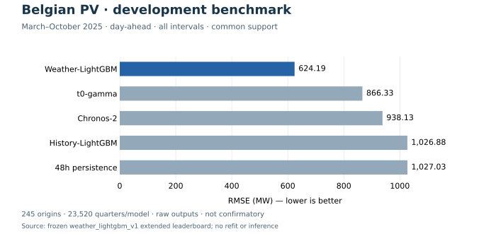

# ☀️ SolarCast

Compare forecasting models on a shared energy-data backtest, starting with
**day-ahead Belgian aggregated solar PV**.

**Same data. Same horizon. Same backtest. Let the results decide.**

[Install and run the offline quickstart](#quick-start) · [Public API guide](docs/public-api.md)

```python
import pandas as pd
from solarcast import BenchmarkConfig, benchmark

# Synthetic installation check, not Belgian PV or accuracy evidence.
pv = pd.DataFrame(
    {
        "target_time": pd.date_range("2025-01-01", "2025-01-12", freq="15min", tz="UTC"),
        "pv_generation_mw": 100.0,
    }
)
config = BenchmarkConfig(
    issue_times=pd.date_range("2025-01-09 11:00", periods=2, freq="D", tz="Europe/Brussels"),
    observation_safety_lag="30min",  # explicit availability approximation
)
results = benchmark(data=pv, config=config, models=["seasonal_persistence_48h"])
results.leaderboard()  # pandas DataFrame, including common support and availability
```

## Why SolarCast?

New forecasting models arrive frequently. Energy teams need to know whether they
improve their own problem, but rankings are hard to interpret when data, horizons,
information availability and metrics differ. SolarCast provides a common framework:

- Sequential rolling-origin backtests with explicit issue times and bounded history.
- Historical NWP vintage selection, distinguishing assumed and observed availability.
- Common-support MAE, RMSE, bias and explicit-reference skill, with failure accounting.
- DST-safe Belgian target days: **92, 96 or 100** quarter-hour intervals.
- Persistence, classical ML and pretrained TSFM adapters with inspectable configuration.

## Quick start

Python **3.11–3.13**. Clone the repository, then create an environment:

```shell
git clone https://github.com/Junaid-Bashir/solarcast-belgium.git
cd solarcast-belgium
python -m venv .venv
# Windows PowerShell: .\.venv\Scripts\Activate.ps1
# Linux/macOS: source .venv/bin/activate
python -m pip install -e .
python examples/quickstart.py
```

The canonical quickstart is offline, uses base dependencies and prints a synthetic
leaderboard. No credentials, weights or GFS preparation are needed. If activation
is unavailable, use `.venv/Scripts/python.exe` (Windows) or `.venv/bin/python`.
**PyPI: not published.** Install from this repository or a local source distribution.
See [installation and examples](examples/README.md).

For real data, supply aware quarter-hour `target_time` interval starts and nullable
numeric `pv_generation_mw`, with enough history and scoring actuals. The issue
schedule and observation safety lag are explicit. `benchmark()` never fetches PV/NWP.

## Supported models

| Public identifier | Type | Training | Forecast weather | Extra |
|---|---|---|---|---|
| `last_value_persistence` | Baseline | None | None | Core |
| `seasonal_persistence_48h` | Baseline | None | None | Core |
| `seasonal_persistence_7d` | Baseline | None | None | Core |
| `lightgbm` | ML | Pre-test fit | None | `lightgbm` |
| `lightgbm_history_radiation_cloud` | ML + NWP | Pre-test fit | Historical GFS | `lightgbm` |
| `t0` | t0-gamma TSFM | Zero-shot | None | `t0` |
| `chronos` | Chronos-2 TSFM | Zero-shot | None | `chronos` |

`available_models()` reports dependency availability without loading ML runtimes.
TSFM weights are local-only by default in the public API; downloads require opt-in.
Weather LightGBM requires a prepared local WeatherStore, with no history-only fallback.
See [public API](docs/public-api.md) for explicit training and weather prerequisites.

## Development benchmark

**These are known-period development results, not an untouched confirmatory
evaluation or evidence of operational readiness.** Earlier development decisions
used this population. A fresh confirmatory period is needed before generalizing.

Elia national Belgian PV, day-ahead at 15-minute resolution, **March–October 2025**:
245 origins at 11:00 Europe/Brussels, 23,520 common quarters per model, including night.

<!-- benchmark-table:start -->
| Model | RMSE (MW), lower is better |
|---|---:|
| Weather-LightGBM | 624.19 |
| t0-gamma | 866.33 |
| Chronos-2 | 938.13 |
| History-LightGBM | 1,026.88 |
| 48h persistence | 1,027.03 |
<!-- benchmark-table:end -->



All five models have 100% forecast availability and zero failed test origins.
Outputs are raw: no clipping or nighttime removal. Weather-LightGBM receives
forecast radiation/cloud; the other models are history-only. Shared scoring does
not imply identical information sets. PV completion plus 30 minutes and GFS
initialization plus six hours are **availability assumptions**, not certified
historical as-of evidence. Revisions and TSFM pretraining overlap remain unresolved.

Values come from the hash-authenticated frozen extended leaderboard, with no new
fitting or inference. See the [full experiment report](docs/experiments/weather-lightgbm-v1.md),
[public aggregate snapshot](docs/benchmarks/README.md), and
[reproducibility limits](docs/reproducibility.md). Exact replay currently requires
local immutable artifacts that are **not distributed with this repository**.

## Methodology and data

```text
Issue T -> select history/NWP eligible under the declared policy -> model
        -> future targets -> evaluator joins actuals -> common-support scoring
```

LightGBM reconstructs historical training features/vintages before joining
fit-time-eligible labels. Failed origins remain visible. Seasonal lags use exact
elapsed UTC durations; next-day targets follow Brussels calendar boundaries.
Read [backtesting](docs/backtesting.md) and [evaluation](docs/evaluation.md).

- **PV:** [Elia national estimates](docs/data/elia.md), with source/schema provenance
  and unresolved historical publication/revision and live-license confirmation.
- **NWP:** [NOAA/NCEP operational GFS 0.25°](docs/data/weather.md) forecast vintages;
  future observed weather and reanalysis are never substituted.

Large datasets, GFS caches, trained models, weights and prediction caches are not
redistributed. Small documented fixtures and aggregate metrics are intentional
exceptions, with [separate third-party terms](THIRD_PARTY.md).

## Documentation and extras

Start at the [documentation index](docs/README.md), [public API](docs/public-api.md)
or [example catalog](examples/README.md). The [research notebook](notebooks/README.md)
is clean source requiring separate local artifacts, not the beginner quickstart.

Install only what you need, for example `python -m pip install -e ".[lightgbm]"`.

| Extra | Adds |
|---|---|
| `lightgbm` | CPU LightGBM training/inference |
| `t0` | Independent t0/PyTorch adapter support |
| `chronos` | Independent Chronos adapter support |
| `weather` | Optional GRIB/Parquet and spatial preparation tools |
| `experiments` | LightGBM and matplotlib research tooling |
| `dev` | Tests, linting, typing and package builds |

Notebook tools have separate [development requirements](notebooks/requirements.txt).
Installing an extra does not download checkpoints.

## Project status and contributing

**Active development / research software: 0.1.0, unreleased.** The API may evolve
before 1.0; PyPI publication comes later. Operational `forecast()`, automatic best-model
selection, ensembles and probabilistic evaluation are not implemented.

See [CONTRIBUTING.md](CONTRIBUTING.md), [SECURITY.md](SECURITY.md),
[CHANGELOG.md](CHANGELOG.md), [roadmap](docs/roadmap.md) and the
[release process](docs/release/README.md).
No production or operational accuracy guarantee is made.

## Citation and license

[CITATION.cff](CITATION.cff) contains minimal project-entity attribution; individual
authorship is intentionally not invented. No DOI is claimed.
Software is [Apache-2.0](LICENSE); external data, weights and fixtures retain their
[own provenance and terms](THIRD_PARTY.md).
