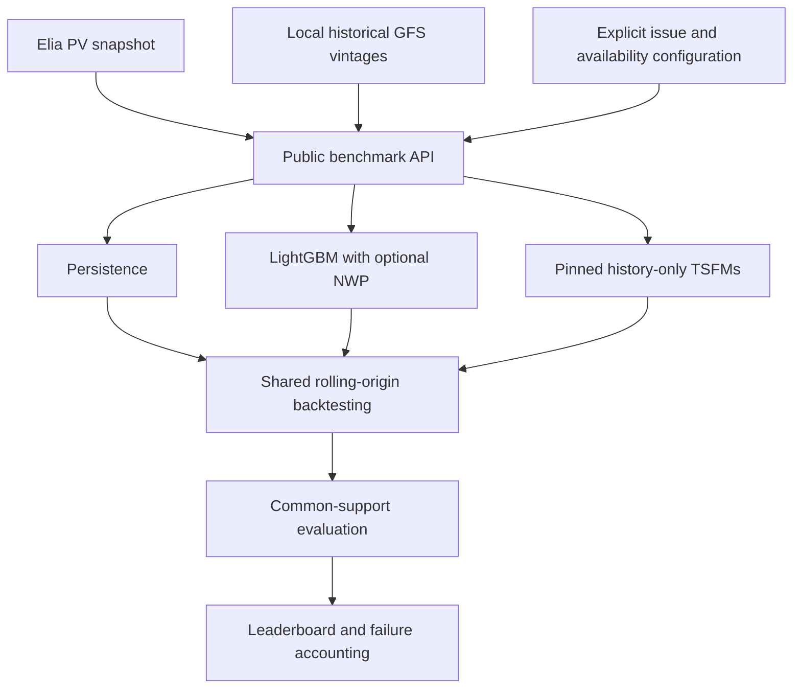

# Architecture

## Implemented foundation



Inputs are prepared separately. NWP is supplied only to its configured adapter;
actual future PV is joined by the evaluator after prediction. The API does not
fetch PV/weather or certify the declared availability assumptions.

The public orchestration layer is `api.py`, exported through `solarcast`:

```text
benchmark(data, config, models) / available_models()
    -> existing adapters + origin-aware training dataset builder
    -> existing sequential backtest + local WeatherStore selection
    -> existing common-support compare_models / BenchmarkResult
```

It requires explicit local input and issue/cutoff configuration, introduces no
alternate evaluation or model algorithms, and leaves lower-level research APIs
available. See [public API](public-api.md) for defaults, result metadata and optional
dependency boundaries. Operational `forecast()` and public `plot()` remain deferred.

A single `solarcast` package in `src/`, built with Hatchling. Distribution metadata
is the version source. Python 3.11–3.13 is supported initially; CI checks the range
boundaries on Linux and the local development version on Windows. Runtime dependencies
are HTTPX, pandas, tzdata, NumPy and pvlib. Apache 2.0 is the software license.
Mypy uses the active interpreter's version so dependency stubs match the installed
environment; CI still checks Python 3.11 explicitly.

`data/elia.py` implements historical retrieval; `_schema.py` contains source mappings
and the single transition boundary; `validation.py` checks normalized results.
Per-row source and retrieval columns preserve provenance through concatenation.
Optional caching/storage remains deferred. LightGBM is an optional model extra.

`features/` groups small calendar, solar and historical-PV functions with shared
input validation, keeping future-known and historical-observed behavior visibly
separate. Explicit
cutoffs bound completed historical intervals without asserting publication timing.
See [feature conventions](features.md) for elapsed lags, cutoff-anchored rolling
windows and the representative national solar-location approximation.

## Module boundaries

Source adapters own provider schemas and provenance. Feature functions distinguish
future-known values from cutoff-bounded history. Forecasting contracts validate
numerical requests/contexts/results, while the backtester owns information selection
and evaluator-side truth lookup. Typed experiment configuration remains separate
from the small public API. Add modules only when they have implemented behavior;
operational forecasting remains a separate future design.

## Implemented forecasting contract

`models/types.py` contains small validated ForecastRequest, ForecastContext and
Forecast objects; `models/base.py` defines the structural Forecaster protocol.
These contracts share one validation boundary.
`predict(context)` receives a context already bound to its request, avoiding two
potentially inconsistent arguments. Histories are explicitly cutoff-limited and
complete, targets are explicit UTC grids, and results enforce exact target coverage.
The common inference protocol does not require fitting. Training data and lifecycle
remain adapter-specific; LightGBM has an explicit fit-time contract.
`models/persistence.py` implements stateless last-value and configurable elapsed
seasonal persistence, returning the same Forecast contract. Missing required
history raises ForecastDataError without fallback. See [baselines](baselines.md).
See [forecasting interface](forecasting-interface.md).

## Implemented backtesting

`backtesting.py` provides one sequential `backtest(model, data, spec)` function,
BacktestSpec/BacktestResult and small substitutable target/availability policies.
The default target policy builds the next Brussels local day; availability must
be selected explicitly. EventTimeCutoff is a labelled completion-time approximation
with configurable safety lag. Model contexts contain only bounded historical PV;
actuals are joined on the evaluator side after prediction. Failure modes are strict
or explicit continuation, retaining every failed-origin target and error details.
The backtester performs no implicit training or feature-building hook. See [backtesting](backtesting.md).

## Data and model boundaries

`models/lightgbm_data.py` reconstructs supervised issue/target rows and shares one
feature recipe with the optional adapter in `models/lightgbm.py`. It reuses the
backtester's context-selection helper and availability policy; labels are joined
separately only when eligible at fit time. Fixed pre-evaluation training needs no
model-specific branch in backtesting/evaluation. Prediction before the fit boundary
is rejected. See [LightGBM methodology](models/lightgbm.md).

`evaluation/metrics.py` implements independent deterministic numerical metrics;
`evaluation/benchmark.py` consumes existing backtest rows and aligns issue/target
keys on common support, preserving failure/availability diagnostics. This package keeps metric definitions separate from result alignment/reporting.
BenchmarkResult exposes numerical summary, leaderboard and grouped DataFrames;
there is no separate reporting framework. See [evaluation](evaluation.md).

Use pandas tables plus small typed request/configuration
objects. Source-specific fields stay in adapters. Observations need target time,
MW value, availability time, and quality information; preserve revisions when
available. Retrieval time alone does not establish historical availability.

Forecasts distinguish issue time and explicit target timestamps, with model identity
and run-level provenance. Canonical timestamps are UTC; target dates and schedules
use Europe/Brussels. Local quarter-hour days can have 92, 96, or 100 intervals.
Elia timestamps identify interval starts. The [Elia investigation](data/elia.md)
requires version-specific adapters: old historical `ods032.measured`, current
historical `ods209.measured_upscaled`, and (later, if needed) near-real-time
`ods210.measured`. Select Belgium/Total for new schemas, Belgium for the old one;
never aggregate overlapping geography/grid totals. Preserve snapshot provenance
across the October 2026 seam. Historical datasets also contain future forecast
rows with null observations; record bounds are not observed-coverage bounds.

The inspected schemas provide no per-record availability or revision timestamp.
Keep availability unknown unless supported by evidence; do not derive it from
target or retrieval time. Named day-ahead products do not establish a general
forecast-vintage archive. Strict as-of evaluation requires more availability
evidence or a clearly labelled approximation.

The model interface separates preparation from prediction: no fit is required by
the common Forecaster protocol. Preparation may train, load pinned pretrained weights or do nothing. The backtester
controls information access; periodic retraining requires a separate explicit policy.
Prediction must not fetch hidden data. There is no generic training input protocol.

## Evaluation and reproducibility

Rolling origins reconstruct the information available at each issue time. Transform
fitting, training labels, tuning, caches, revisions and future weather must follow
the same cutoff discipline. Keep scoring observations separate from prediction inputs.
Use shared target grids/masks and report missing predictions and failures. Distinguish
information-set tracks and preserve a held-out test period.

Local Parquet and metadata files are the intended storage approach when needed.
Future runs should save resolved TOML configuration, seeds, environment, code/model
revisions, data fingerprints and availability assumptions. No database or service is
required. Heavy ML dependencies will remain optional.

## Decisions still open

- PyPI distribution and import-name availability (names are provisional).
- Elia upscaling continuity, publication timing and revisions; live license confirmation.
- Exact local issue schedule and publication-lag policy.
- Local-calendar persistence policy and a justified nRMSE denominator; daylight
  scoring is an explicitly labelled representative-point subset, not the default.
- Individual citation metadata and release process.
- Future adapters, model licenses, and benchmark environment locking.
