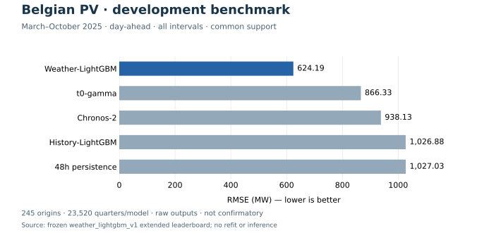

# Development benchmark

**Known-period development result — not independent confirmation or operational validation.**

Target: Belgian national PV generation, MW. March–October 2025; 245 issues at 11:00 Brussels, next-day quarter-hour targets including night. All five models cover 23,520 common scored quarters with zero failed origins.

<!-- benchmark-table -->

The table comes directly from the existing [public CSV](../benchmarks/weather-lightgbm-v1.csv). [Provenance](../benchmarks/README.md) describes authentication and source hashes.

## Interpretation

In this development experiment, adding forecast radiation/cloud to LightGBM produced a larger improvement than switching history-only LightGBM to the evaluated zero-shot TSFMs. Weather-LightGBM receives a richer information set. This is not a general architecture ranking or causal claim.

## Methodology and limits

Validation selected history+radiation+cloud; the 2025 holdout was already known. PV event-time lag and GFS init-plus-six-hours approximate availability. Revisions and TSFM pretraining overlap remain unresolved. Require a fresh confirmatory period before operational claims.

Read the [weather report](../experiments/weather-lightgbm-v1.md), [LightGBM report](../experiments/lightgbm-baseline-v1.md), [TSFM report](../experiments/tsfm-zero-shot-v1.md), [reproducibility](../reproducibility.md) and [limitations](limitations.md). No research was rerun to build this site.
